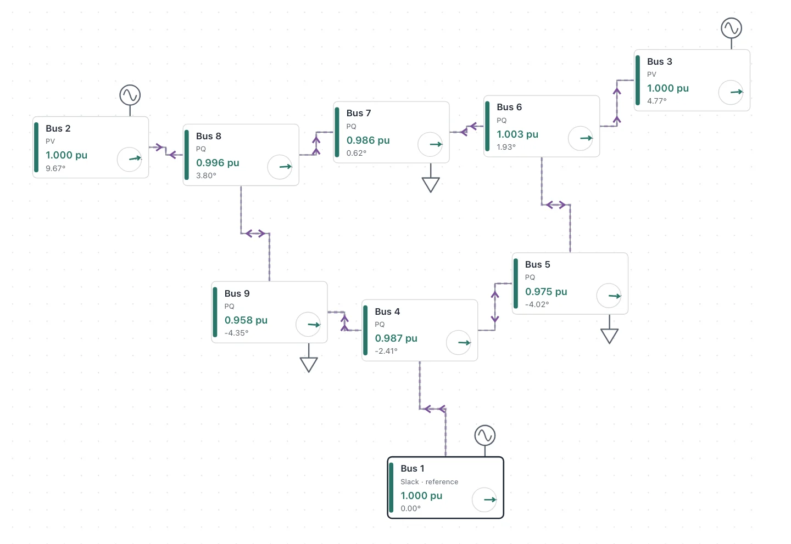

Load flow, also called power flow, answers a steady-state question about an AC network: given what each generator is set to produce and what each load draws, what are the voltage magnitude and phase angle at every bus, and how much power moves through each line? A bus is a node where lines, generators, and loads connect. [Load Flow Analysis](/experimental/load-flow/) is a browser tool I built that puts a network, its inputs, the solver, and the results on one page. I could change an input and read the new voltages and flows without moving between a model and a separate output view, and that made load flow easier to reason about than equations alone.

## The power flow equations

Line impedances form an admittance matrix $Y$, and bus currents follow from bus voltages through $I = YV$. If the inputs were currents, one linear solve would finish the job.

The inputs are powers. Complex power at bus $i$ is voltage times conjugate current, so the unknown voltages multiply each other:

$$
\begin{aligned}
S_i = P_i + jQ_i &= V_i I_i^* \\
&= V_i \sum_j Y_{ij}^* V_j^*
\end{aligned}
$$

Separating the real and reactive parts, with $Y_{ij} = G_{ij} + jB_{ij}$ and $\theta_{ij} = \theta_i - \theta_j$, gives two real equations for every bus:

$$
\begin{aligned}
P_i &= \sum_j |V_i||V_j| \big( G_{ij}\cos\theta_{ij} \\
&\qquad\qquad + B_{ij}\sin\theta_{ij} \big) \\
Q_i &= \sum_j |V_i||V_j| \big( G_{ij}\sin\theta_{ij} \\
&\qquad\qquad - B_{ij}\cos\theta_{ij} \big)
\end{aligned}
$$

These are sums of products of unknown magnitudes with sines and cosines of unknown angles. That makes them nonlinear, so they are usually solved by iteration.

## PQ, PV, and slack buses

Each bus has four quantities, $|V|$, $\theta$, $P$, and $Q$, and two equations. Two of the quantities have to be given, and which two depends on the equipment at the bus:

- **PQ (load) bus:** $P$ and $Q$ are given, because a load is described by what it draws. The solve finds $|V|$ and $\theta$.
- **PV (generator) bus:** $P$ and $|V|$ are given, because a generator is set to a real power output and a voltage setpoint. The solve finds $\theta$, and $Q$ is whatever it takes to hold that voltage.
- **Slack bus:** $|V|$ and $\theta$ are given. $P$ and $Q$ come out of the solution.

The slack bus is there for two reasons. The equations contain only angle differences, so one bus has to define zero. And real power cannot be specified everywhere, because line losses are unknown until the voltages are known, so one source has to make up the difference.

The solve uses only the equations whose left side is known: $P$ at every PV and PQ bus, and $Q$ at every PQ bus. That leaves one unknown angle for every bus except the slack and one unknown magnitude for every PQ bus. Line flows follow directly from the voltages at each end once the solve is done.

## Solving the equations with Newton–Raphson

Newton–Raphson is the usual way to solve these equations, an approach [Tinney and Hart](https://doi.org/10.1109/TPAS.1967.291823) showed to be efficient in 1967. It replaces them with a linear approximation at the current guess, solves that, and repeats. The gap between the specified power at a bus and the power the equations give at the current guess is the mismatch:

$$
\begin{aligned}
\Delta P_i &= P_i^{\text{spec}} - P_i(\theta, |V|) \\
\Delta Q_i &= Q_i^{\text{spec}} - Q_i(\theta, |V|)
\end{aligned}
$$

The Jacobian $J$ holds the partial derivatives of the calculated power with respect to the unknowns, evaluated at the current guess:

$$
J = \begin{bmatrix} \partial P/\partial\theta & \partial P/\partial|V| \\ \partial Q/\partial\theta & \partial Q/\partial|V| \end{bmatrix}
$$

Each iteration solves this linear system, adds the result to the guess, and recalculates the mismatch and Jacobian at the new point:

$$
J \begin{bmatrix} \Delta\theta \\ \Delta|V| \end{bmatrix}
=
\begin{bmatrix} \Delta P \\ \Delta Q \end{bmatrix}
$$

Close to a solution, each step squares the mismatch, up to a constant factor, which is the quadratic convergence Newton’s method is known for.

The tool works in per unit, where 1 pu of voltage is nominal and 1 pu of power is 100 MVA in its reference cases. It begins from a flat start, with every unknown magnitude at 1 pu and every unknown angle at zero, and stops when the largest mismatch falls to $10^{-6}$ pu.

## Client-side state and data flow

The `LoadFlowWorkspace` component keeps the network in a single editor state. Choosing one of the seven reference cases or an empty network replaces that state, and edits update it. Five of the cases are standard benchmark networks of 9 to 118 buses, adapted from MATPOWER.

![Data flow through the tool. Reference cases and user edits feed the editor state. toLoadFlowCase reduces it to the electrical model as a JSON string called modelKey, and the load slider scales that into the model. The solver validates the model and runs Newton–Raphson on the main thread. A converged check then passes results to the single-line diagram, summary strip, and tables. A dashed path carries bus positions and selection from the editor state straight to the single-line diagram, with no solve.](/assets/blog/ac-load-flow-newton-raphson/solver-architecture.webp)

`toLoadFlowCase` copies the electrical model out of that state for the solver, without bus positions or the selection. The model is memoized on the JSON string of that copy, `modelKey`, and on the load slider’s value. The slider scales every load’s $P$ and $Q$ together and leaves generator $P$ setpoints fixed, so the slack bus supplies all of the added real power and the added losses. A Case JSON view shows the scaled model that the solver receives.

## The solver runs during render

The tool solves as the inputs change, without a Run button or a worker. `runLoadFlow` is called inside a `useMemo`, so a new model reruns it during render, on the main thread.

![Sequence diagram with four participants: the user, the workspace, the solver, and the single-line diagram. Moving the load slider makes the workspace scale loads and call the solver, which validates the case, builds Y, and takes a flat start. It then iterates up to 30 times, calculating P and Q, stopping if the mismatch is at most 10 to the minus 6 pu, solving the Jacobian, and updating angles and voltages, before computing line flows. The workspace passes converged voltages and flows to the diagram. Dragging a bus sends a new position to the workspace, where modelKey is unchanged, so the last result is reused and the diagram only reroutes its lines.](/assets/blog/ac-load-flow-newton-raphson/load-slider-sequence.webp)

A slider step on the 118-bus case takes about 50 ms in Chromium on an Apple M4 when the solve converges, and about 140 ms when it fails, because a failed solve runs all 30 iterations. Dragging a bus takes the second path in the figure: its new position changes the editor state but not `modelKey`, so nothing is solved again.

## Reading the single-line diagram

A single-line diagram draws each balanced three-phase circuit as one line. In the tool, each bus is a card showing its type, voltage magnitude, and angle relative to the slack bus. Its color marks fixed voltage bands that are visual guides rather than equipment limits. Real power is drawn in solid blue and reactive power in dashed purple, together or one at a time. Stroke width and the speed of the animated dashes grow with the power. The animation shows only direction and size, because a steady-state solution does not change over time, and it can be paused.

Each line is drawn as two halves with separate arrows, because the power at its two ends can differ. The tool reports power as positive into the line at each end, following [MATPOWER’s branch convention](https://matpower.org/docs/ref/matpower7.1/lib/idx_brch.html), and the sum of the two is what the line absorbs. In the IEEE 9-bus case below, the arrows on the Bus 2–Bus 8 branch meet in the middle, with reactive power entering from both ends. On the Bus 5–Bus 6 line, they point apart: the line delivers reactive power to both buses while real power crosses it in one direction.

Hovering, focusing, or tapping an element shows its numbers, and collapsed tables list every bus and branch. Buses can be dragged, and an Arrange buses button returns them to an automatic layout. The diagram, including its dragging and automatic layout, was [the harder part of building the tool for me](/blog/small-interactive-tools-with-a-coding-agent/).

## Limits and future work

The network is not easy to edit. The diagram is only for selecting buses and lines and moving buses. The network’s parameters are edited in a form below it, one bus or line at a time, and that form starts collapsed, as does a separate panel for adding and connecting buses. The form also has no field for shunt capacitors, though the solver models the ones in the IEEE cases. And the tool shows only the current solution, so seeing what an edit changed means noting the voltages before it and comparing them afterward. Editing on the diagram, with each bus shaded by how far its voltage moved from a saved solution, would let the diagram show both the edit and what it changed.

A PV bus’s $Q$ is whatever it takes to hold its voltage. The case data gives each generator reactive limits, but the solver does not enforce them, so under heavy load the tool can show healthy voltages that depend on generators exceeding theirs. In the IEEE 14-bus case at 150% load, it reports “Converged” with every bus at 1.00 pu or above, while all four PV generators are past their limits: the one at Bus 2 supplies 101 MVAr against a limit of 50. Holding those four at their limits and solving again, with the slack bus still unlimited, drops Bus 14 to 0.903 pu. “Converged” here means only that the power balance holds at every bus, not that generators stay within their limits or lines within their thermal ratings.

Scale is the last limit. Each bus connects to only a few others, so most of the Jacobian is zero: the 118-bus case’s 181 × 181 matrix averages about six nonzero entries per row. The solver still stores it as a dense matrix and solves it by Gaussian elimination, at a cost that grows with the cube of the number of unknowns. At 181 unknowns, that cost fits within the slider-step times above, but a network with 100 times as many unknowns would need a matrix of about 330 million entries and about a million times the work per iteration. The tool’s cases are small next to the utility models I had seen in PSS/E, and I did not try anything that large in the browser.
