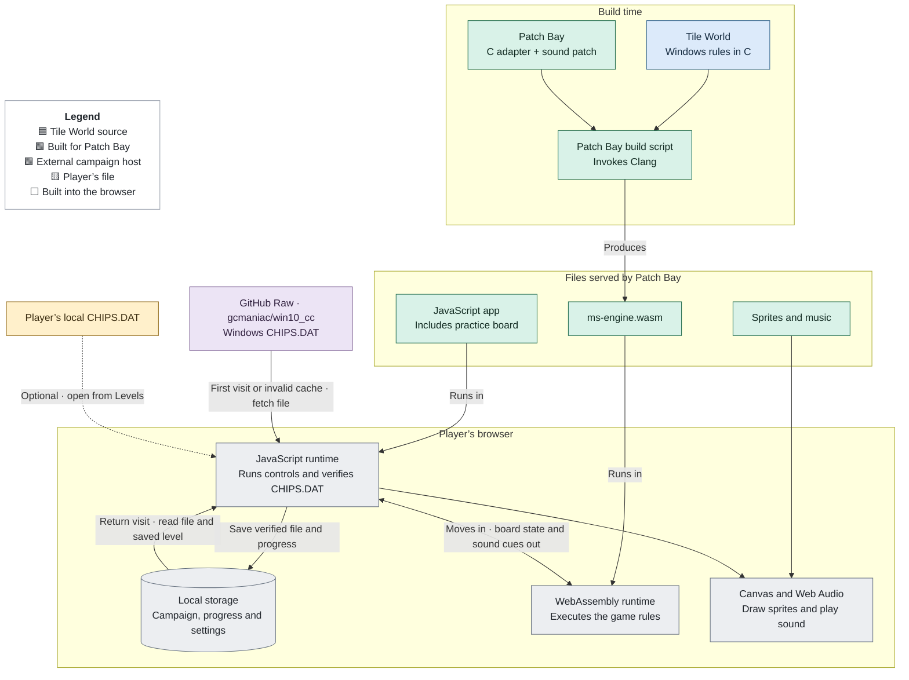

# Patch Bay

Patch Bay plays the 149-level Windows edition of _Chip’s Challenge_ with keyboard or touch controls at `/experimental/patch-bay/`.

## Architecture

- **First visit.** The browser downloads `CHIPS.DAT` directly from the external host, checks its SHA-256, saves the verified file locally when storage is available, and opens Lesson 1. The default URL points to a specific revision. [Campaign file on GitHub Raw](https://raw.githubusercontent.com/gcmaniac/win10_cc/74da8199a3e45b7d154f08a683132761fabd7663/direct_method/chips_challenge/CHIPS.DAT)
- **Return visit.** The browser checks the saved file again and opens the current level from saved progress. A valid local copy lets it skip the campaign download.
- **Missing or damaged copy.** The browser tries the external host again. If the download fails or its hash differs, the two-chip **Bench test** opens. Players can also import their own copy through **Levels → Open CHIPS.DAT**.

To change the external host, set `NEXT_PUBLIC_PATCH_BAY_CAMPAIGN_URL` before building. The host must allow cross-origin reads. [Campaign playthrough and verification](../../../../docs/patch-bay-verification.md)
